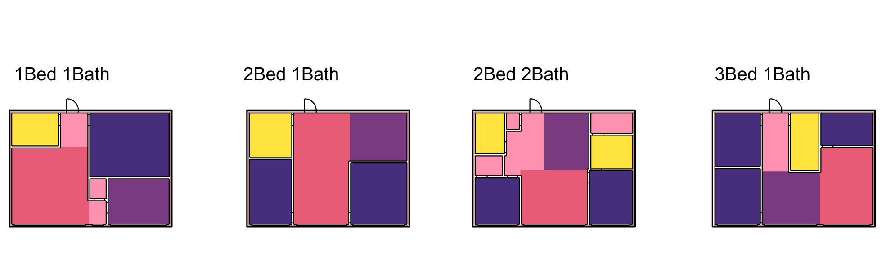

# SpatialGH_InverseDesign


This is the software repo for our paper on floorplan inverse design. It contains a Grasshopper plugin, example definitions, and related data.
The plugin is available on Windows x64.

## Installation


1. **Find your Grasshopper components folder.** In Rhino, open Grasshopper, then go to `File > Special Folders > Components Folder`. This is normally:
   ```
   %APPDATA%\Grasshopper\Libraries
   ```
   (i.e. `C:\Users\<you>\AppData\Roaming\Grasshopper\Libraries`).

2. **Unblock the files if needed.** If the zip was downloaded from the web, Windows may flag the `.zip` files as blocked. Right-click on the `.zip` folder → Properties → check "Unblock" → OK.

3. **Unzip the plugin there.** Extract `SpatialGH_InverseDesign.zip` directly into that `Libraries` folder, so you end up with:
   ```
   Libraries\SpatialGH_InverseDesign\SpatialGH.gha
   Libraries\SpatialGH_InverseDesign\... (dependency DLLs)
   ```

4. **Restart Rhino/Grasshopper.** The plugin's components should now appear on the Grasshopper ribbon.

5. **Sign in and activate.** Add the `Spatial Sign In` component and complete the browser sign-in with an activated Spatial account.

## Setting the database path

#### Furniture database
1. Open `Spatial_bacis.gh`in Grasshopper.
2. Find the yellow panel with "Furniture JSON".
3. Set it to the `database\furniture4.json` path in this repo, e.g.:
   ```
   C:\Project\SpatialGH_InverseDesign\database\furniture4.json
   ```

#### Inverse design database

1. Open `InverseDesign_walkthrough.gh` or `InverseDesign_examples.gh` in Grasshopper. `InverseDesign_examples.gh` needs to open with `InverseDesign_examples.3dm` in rhino.
2. Find the panel that points to the database folder (a yellow panel marked as "Folder containing the database").
3. Set it to the `database/` folder of **this** repo, given as a folder path, e.g.:
   ```
   C:\Project\SpatialGH_InverseDesign\database
   ```
   Keep the following files together in the database folder:

   - `database.json`
   - `database.search-index.json`
   - `boundary_score.json`
   - `srds_score.json`


## Example files

- **`Spatial_basics.gh` & `Spatial_basics.3dm`**: walks through the plugin's basic functions, including loading an apartment, basic fitting functions, editing floorplans from our web UI, and fitting furniture. Watch this [tutorial video](https://www.youtube.com/watch?v=-96ackTkyMQ) to see how it works.
- **`InverseDesign_walkthrough.gh`**: walks through the plugin's functionality related to inverse design: the inverse design loop, inverse design with filtering, adding a room, and removing a room. Watch this [tutorial video](https://youtu.be/sGq6Yk5CWIo) to see how it works.
- **`InverseDesign_examples.gh` & `InverseDesign_examples.3dm`**: shows the results produced for several different inputs on the same boundary. 

  


## Troubleshooting

- **Many components show activation errors:** add `Spatial Sign In` and press **Activate** to sync your Spatial account.
- **Components still show errors after activation:** right-click on the canvas → **Recompute**.

## License

MIT — see [LICENSE](LICENSE).
