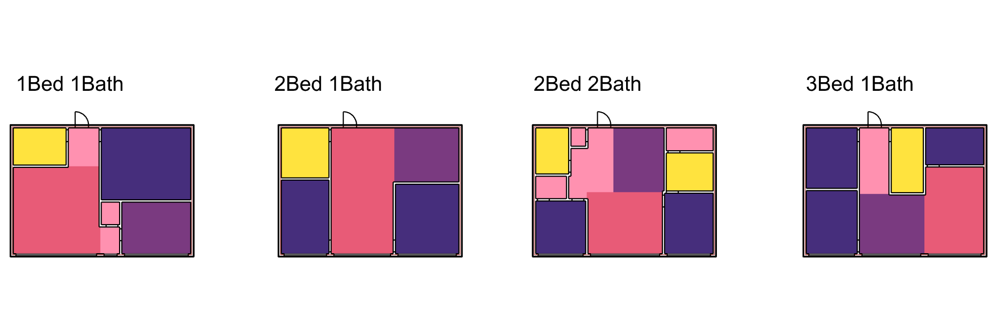

# SpatialGH_InverseDesign


This is the software repo for our paper on floorplan inverse design. It contains a Grasshopper plugin (`SpatialGH_InverseDesign.zip`), two example definitions (`InverseDesign_walkthrough.gh` and `InverseDesign_examples.gh`), and the data they rely on (`database/`).
The plugin is available on Windows x64. The current package (2026-10-22) targets Rhino 8 running .NET 8 and includes the faster reference search and inverse-design workflows.

## Installation

When updating, close Rhino and replace the existing `SpatialGH_InverseDesign` plugin folder with the newly extracted folder. Keep the matching `SpatialGH.gha`, `SpatialOS.dll` and dependency DLLs together.

1. **Find your Grasshopper components folder.** In Rhino, open Grasshopper, then go to `File > Special Folders > Components Folder`. This is normally:
   ```
   %APPDATA%\Grasshopper\Libraries
   ```
   (i.e. `C:\Users\<you>\AppData\Roaming\Grasshopper\Libraries`).

2. **Unblock the files if needed.** If the zip was downloaded from the web, Windows may flag the `.zip` files as blocked. Right-click on the `.zip` folder → Properties → check "Unblock" → OK.

3. **Unzip the plugin there.** Extract `SpatialGH_InverseDesign.zip` directly into that `Libraries` folder, so you end up with:
   ```
   Libraries\SpatialGH_InverseDesign\SpatialGH.gha
   Libraries\SpatialGH_InverseDesign\... (dependency DLLs)
   ```


4. **Restart Rhino/Grasshopper.** The plugin's components should now appear on the Grasshopper ribbon.

5. **Sign in and activate.** Add the `Spatial Sign In` component (`Spatial > Registration`), press **Activate**, and complete the browser sign-in with an activated Spatial account. This replaces the older email/license-key workflow.

## Setting the database path

Both example definitions need to know where the data lives:

1. Open `InverseDesign_walkthrough.gh` or `InverseDesign_examples.gh` in Grasshopper.
2. Find the input that points to the database folder (a path/string input feeding the plugin's database-loading component).
3. Set it to the `database/` folder of **this** repo, given as a folder path (not a specific file inside it), e.g.:
   ```
   C:\Project\SpatialGH_InverseDesign\database
   ```

Keep the following files together in the database folder:

- `database.json`
- `database.search-index.json`
- `boundary_score.json`
- `srds_score.json`

The prebuilt search index enables a fast first search and works after copying the folder to another machine. If the database changes or the index is missing, the plugin rebuilds the index automatically; that first search takes longer. When publishing an updated database, run one search first and include the refreshed index. `test.json` is also included as sample data.

## Example files

- **`InverseDesign_walkthrough.gh`**: walks through all of the plugin's functionality: the inverse design loop, inverse design with filtering, adding a room, and removing a room. Watch this [tutorial video](https://youtu.be/sGq6Yk5CWIo) to see how it works.
- **`InverseDesign_examples.gh`**: shows the results produced for several different inputs on the same boundary. This file references geometry stored in `InverseDesign_examples.3dm`.

  


## Troubleshooting

- **Many components show activation errors:** add `Spatial Sign In` and press **Activate** to sync your Spatial account.
- **Components still show errors after activation:** right-click on the canvas → **Recompute**.

## License

MIT — see [LICENSE](LICENSE).
